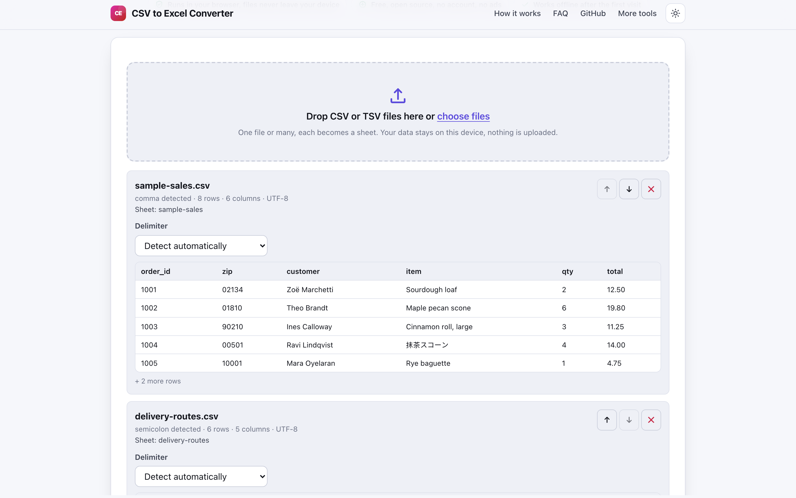
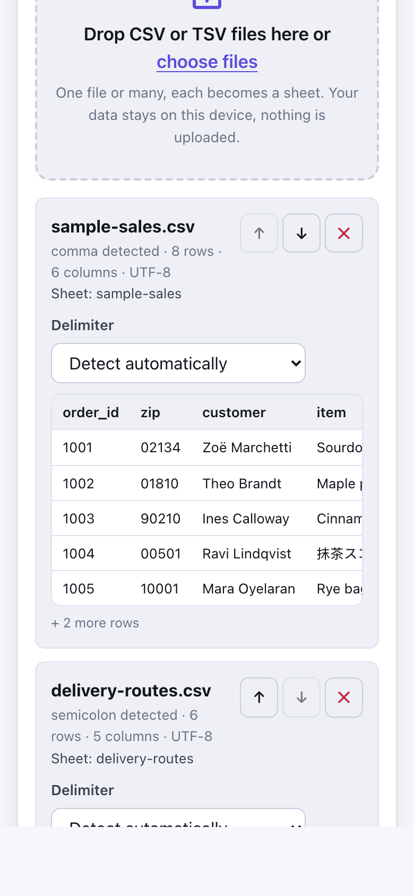

# CSV to Excel Converter

> Turn CSV files into a real XLSX workbook in your browser, with delimiter detection and no upload.

**🌐 Use it now: [turhe123.github.io/csv-to-excel-local](https://turhe123.github.io/csv-to-excel-local/)** · free · open source · runs in your browser · works offline


## Why

CSV to Excel Converter is a free, open-source alternative to the CSV to Excel pages on Convertio and Zamzar, which upload your file to a server, apply daily conversion limits, show ads, and ask for a paid plan for files over 100 MB. Here your files never leave your device, there is no account, no ads and no limits, it works offline, and you can install it as an app.

## Screenshots

<p align="center"></p>

<p align="center"><em>CSV to Excel Converter in the browser, light theme</em></p>

<p align="center"></p>

<p align="center"><em>CSV to Excel Converter on a phone</em></p>

## Features

- Drop one or many files, or pick them with the keyboard-accessible file input.
- Automatic delimiter detection (comma, semicolon, tab, pipe) with a per-file manual override.
- Each file becomes a card showing the detected delimiter, row and column counts, encoding, and a five-row preview.
- Reorder cards with move up / move down buttons, or remove them. Card order is sheet order.
- One sheet per file, named after the file: shortened to 31 characters, cleaned of characters Excel forbids, and de-duplicated.
- Options (all on by default):
  - First row is a header: bold header styling and a frozen top row.
  - Keep text columns as text: columns where a value has a leading zero (like `02134`) or more than 15 digits are stored as text. Clean numeric columns are stored as real numbers.
  - Auto fit column widths (capped at 60 characters).
- Values starting with `=` are written as text, never as formulas.
- Cells over 32,767 characters are truncated, with a visible warning.
- Files beyond Excel's limits (1,048,576 rows or 16,384 columns per sheet) show a clear message and an option to split into several sheets.
- Ragged rows are padded; empty files and unsupported file types are rejected with a visible error.
- Encoding: UTF-8 (with BOM stripped), UTF-16 with BOM, and a Windows-1252 fallback when UTF-8 is invalid. Non-Latin text round-trips.
- Parsing and workbook building run in a Web Worker, with progress bars.
- The output is named after the file (for example `sales-2026.xlsx`), or `workbook.xlsx` for several files.
- Light and dark themes, usable at 390px wide, installable as a PWA.

**Input:** `.csv`, `.tsv`, `.tab`, `.txt` text files.
**Output:** `.xlsx` workbook.
**Limits:** no cap is imposed by the tool; the practical limit is your browser's memory. Excel's own limits (1,048,576 rows, 16,384 columns, 32,767 characters per cell) apply as described above.

## How to use

1. Open the page and drop one or more CSV or TSV files onto the drop zone (or choose them).
2. Check each card: confirm the detected delimiter or pick another, and reorder or remove files.
3. Set the options: header styling, keep text columns as text, auto fit widths.
4. Click **Download workbook.xlsx** (the button shows the real output name).
5. Open the file in Excel, LibreOffice or Numbers.

## Privacy

- Nothing is uploaded. Files are read and converted in your browser.
- No cookies.
- Page views are counted anonymously with [GoatCounter](https://www.goatcounter.com/), which is cookieless and open source.
- After the first visit, a service worker caches the page so it works offline.

## Run it locally

```sh
git clone https://github.com/turhe123/csv-to-excel-local
cd csv-to-excel-local
python3 -m http.server 4173
```

Then open http://127.0.0.1:4173/. There is no build step.

## Tests

```sh
npm i -D @playwright/test && npx playwright install chromium
npx playwright test
```

## Third-party code

Bundled in `vendor/`, with licenses included:

| Library | Version | License |
| --- | --- | --- |
| [Papa Parse](https://www.papaparse.com/) | 5.5.3 | MIT |
| [SheetJS (xlsx)](https://sheetjs.com/) | 0.20.3 | Apache-2.0 |

## Built with AI

CSV to Excel Converter was written by [Claude Code](https://claude.com/claude-code) inside an automated pipeline, from a plain-English spec. No code or assets from any commercial product were used; it is a clean-room implementation of a feature set, not a copy.

What that means in practice:

- The full source is in this repo under the MIT license. Read it before you trust it with your files.
- Everything runs in your browser. It makes no network requests except an anonymous, cookieless page-view count (GoatCounter); your files never leave the device.
- The page is tested headless in Chromium (Playwright) before every release, but it has had less human review than hand-written software. Bug reports and pull requests are welcome.

## Support ❤️

If this tool saved you time, you can support its upkeep on [Ko-fi](https://ko-fi.com/leodavidai).

## More free web tools

Find more at [turhe123.github.io/web-tools](https://turhe123.github.io/web-tools/).

## License

MIT © Or Davidai Bachar
